### Introduction

- This work is heavily inspired by the [*Toy Models of Superposition*](https://transformer-circuits.pub/2022/toy_model/index.html) work.

- In the original paper the authors studied toy autoencoders consisting of two layers with a ReLU activation, and a bottleneck after the first layer.

---

### Introduction

- The input consisted of numbers $x_i$ (**features**), which could activate with a probability $p$, or remain inactive. When they became active, they took values in the $[0,1]$ range.

- Each feature can be given an additional importance weight.

- The error was measured using MSE.

---

### Introduction

- At the bottleneck, each feature $x_i$ is represented by its **embedding** vector $f_i$.

- The main result of *Toy Models of Superposition* is that for sparse enough features (small value of $p$) the model stores more features than the bottleneck has dimensions (superposition).

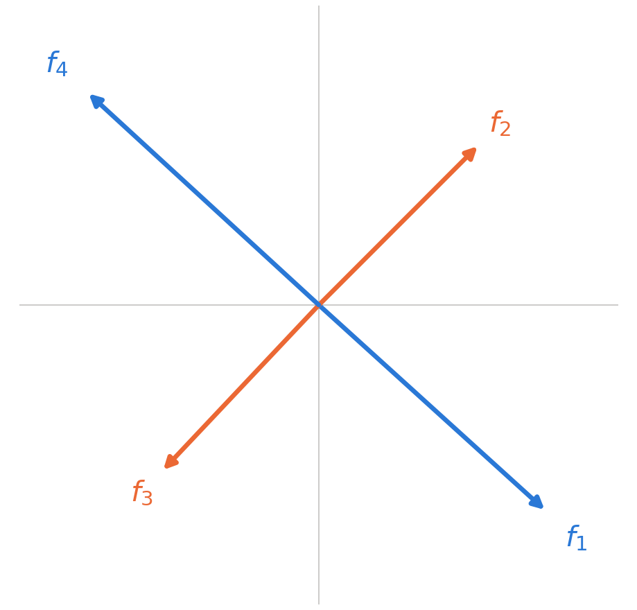

---

### Introduction

- *Toy Models of Superposition* observes deformed, non-uniform geometries only when the features themselves are non-uniform — differing in importance, sparsity, or being correlated.

- **For identical features, however, it finds regular geometric structures, such as antipodal pairs, triangles and pentagons. Its authors remark that this structure "seems 'too elegant to be true'" and that "there's a good chance it's at least partly idiosyncratic to the toy model we're investigating".**

---

### Introduction

- This work confirms this suspicion. It turns out that non-symmetric solutions give better performance, but the shallow models are just not expressive enough to "discover" them.

- In this work we study deeper models, which, thanks to their increased expressivity, discover better "strategies" resulting in a smaller MSE.

- We also introduce the theoretically best possible solution to this task (like a model with infinite expressivity), and use it as a benchmark to compare against when analyzing our models.

---

### Setup

- We will be working with models consisting of a linear encoder followed by multiple MLPs with a bilinear activation:

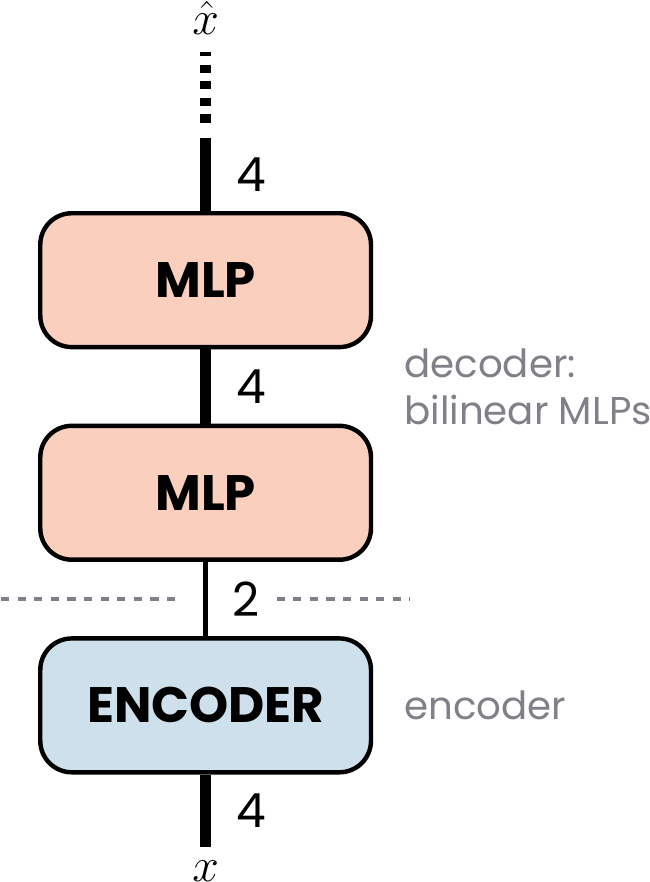

- Each model will be given 4 features, all with the same $p = 0.2$.

---

### Setup

- For our analysis we divide the model into two parts:

    - **Encoder**: consisting of the first linear layer.
    - **Decoder**: consisting of all the following MLPs.

- The encoder introduces the bottleneck, which forces the feature embeddings to live in a 2D space.

- We will analyze the geometries of feature embeddings precisely at this bottleneck.

---

### Let's play a game

- Imagine that you and your friend are playing a game.

- You are the encoder, and your goal is to arrange the feature embeddings in such a way that will make your friend's (the decoder's) life easier.

- That is, you should come up with the best possible arrangement of 4 feature embeddings to maximize the chances that your friend will guess correctly what the true input was before going through the bottleneck.

---

### Trivial strategy

- The trivial strategy is to pair the features, and arrange them in the following way:

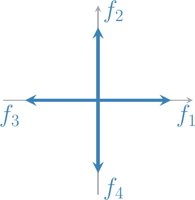

---

### Trivial strategy

- Let's focus for now on the horizontal line segment spanned by the $f_1$ and $f_3$ feature embeddings. Let's denote it as $s$.

- This arrangement has one flaw. When two features in the same pair are co-active, the decoder cannot perfectly distinguish this case from a scenario in which only one of them was active:

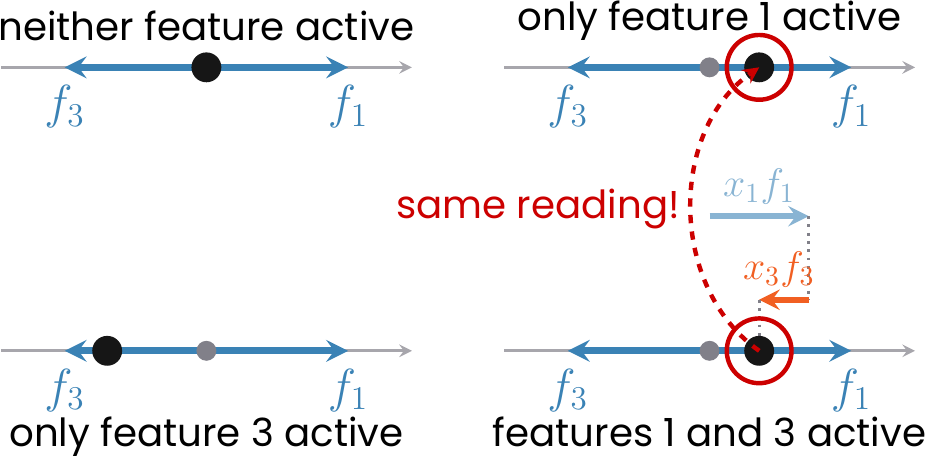

- So, he would have to **average** over these two scenarios.

---

### Trivial strategy

- You might ask: "Why should the decoder use the average? Can't he use the median or the maximum instead?"

- This comes from the fact that we are using MSE to measure the performance of the whole system.

---

### Interlude - MSE

- Let's imagine you are given a bunch of points on a vertical line. (The unusual choice of vertical direction will become clear in a few slides.)

- You can output **just a single point**.

- The value you output will be compared with all the points that you were given.

- The sum of squared distances to each of these points is your final "score", and you should make it as small as possible.

- What should you do?

---

### Interlude - MSE

- It turns out that the best you can do in this situation is to just output the average of the points that were presented to you:

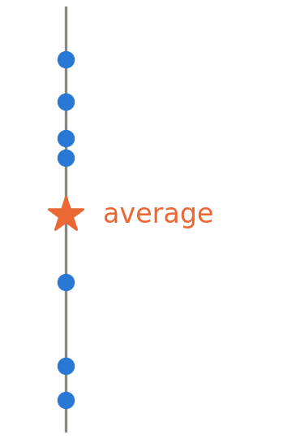

- This shows that **the choice of the loss function dictates the behavior of the decoder**.

---

### Trivial strategy - decoder's action

- We've shown that the decoder should use the average to achieve his goal. But how should he use it given the reading on the horizontal line segment $s$?

- Let's first take a look at what the decoder is seeing, when given a bunch of samples and trying to predict the true value of the feature $x_1$:

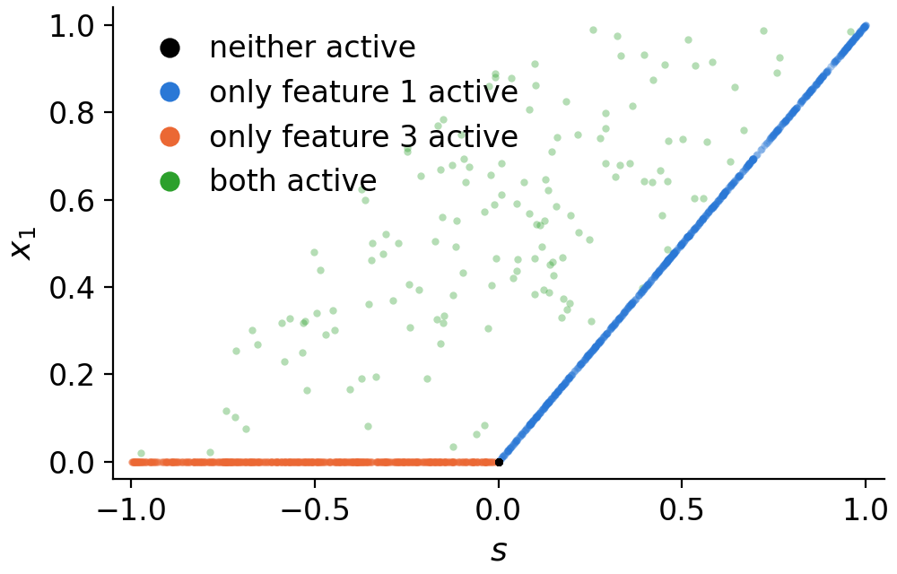

---

### Trivial strategy - decoder's action

- We can clearly see that cases with both features active (green) fall on the same values of $s$ as other cases.

- So the decoder can:
    - divide $s$ into very tiny bins,
    - for each such bin collect all the samples that fall into it,
    - return the prediction of the first feature (denoted as $\hat{x}_1$) as the average of these points.

- This approach justifies our previous choice of the vertical direction in the "MSE interlude".

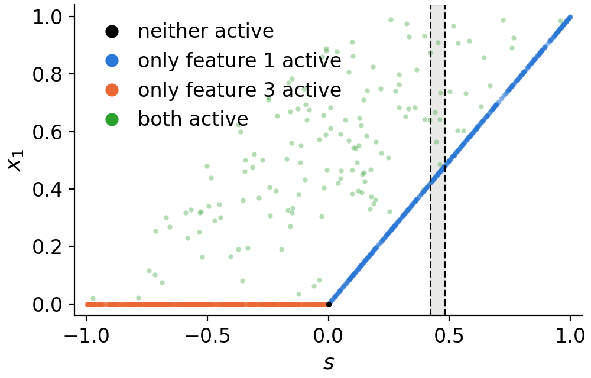

---

### Trivial strategy - decoder's action

- For very fine bins the decoder gives the following predictions:

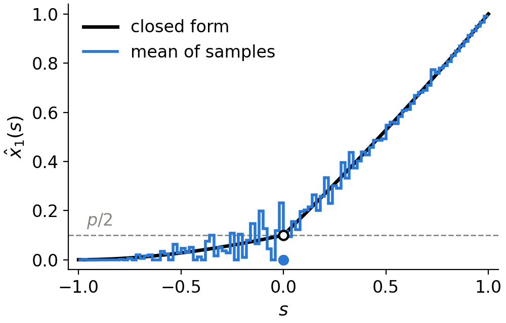

---

### Trivial strategy - decoder's action

- In this figure we are also presenting a closed-form solution to the best possible prediction the decoder can make.

- However, its derivation is quite difficult and requires knowing the true data-generating process — something we usually lack, having access only to data samples.

- Still, given an infinite amount of samples and infinitely narrow bins, the binned predictions would converge to the closed form.

- Moving on, we will switch between the closed-form solution and the binned average, wherever more convenient.

---

### Trivial strategy - decoder's action

- We should remember that readings on the same line segment $s$ are used to predict both $\hat{x}_1$ and $\hat{x}_3$. Let's plot them together.

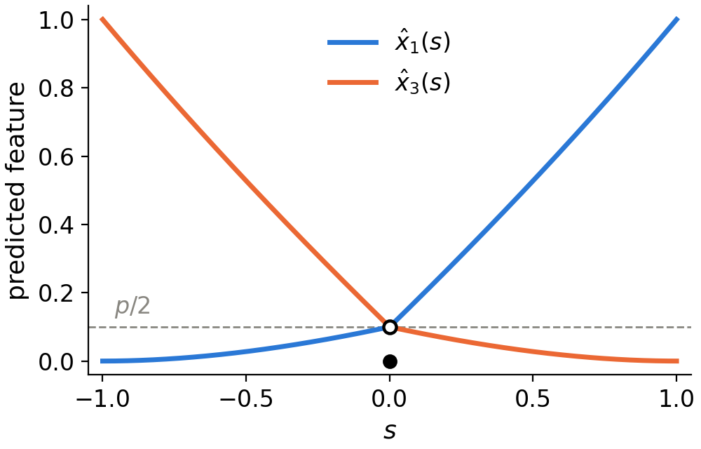

---

### Better strategies - making feature embeddings asymmetrical

- The above decoders were the best possible ones for the **symmetrical feature embeddings**.

- However, we can make these features asymmetrical:

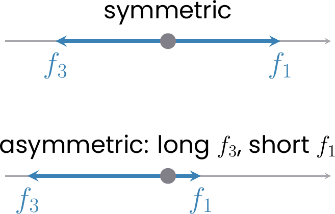

---

### Better strategies - making feature embeddings asymmetrical

- We can derive the best theoretical decoders for this new geometry, and obtain the following result:

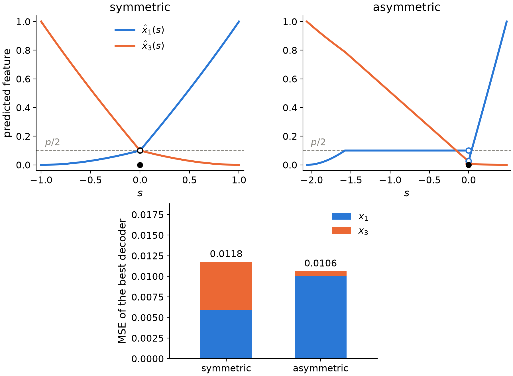

- We can see that **the asymmetrical approach gives a smaller overall MSE!**

---

### Better strategies - opening the pair

- Another way to improve the decoder's chances is to "open" the feature embedding pair:

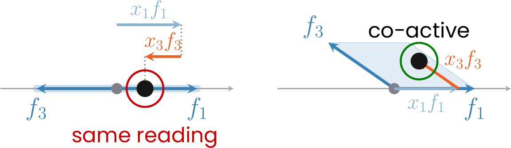

- With this setup:
    - in a situation with just a single feature being active, we still get a reading on one of the feature embeddings,
    - when two features are co-active we get a reading inside the parallelogram spanned by the feature embeddings, which is distinguishable from the case with just a single feature being active.

---

### Better strategies - opening the pair

- This approach is not perfect, however. We need to remember that we have to store four different embeddings in a 2D plane.

- Thus, tilting the $f_3$ feature embedding makes it overlap with the $f_2$ one — we will call this effect the **interference** between features:

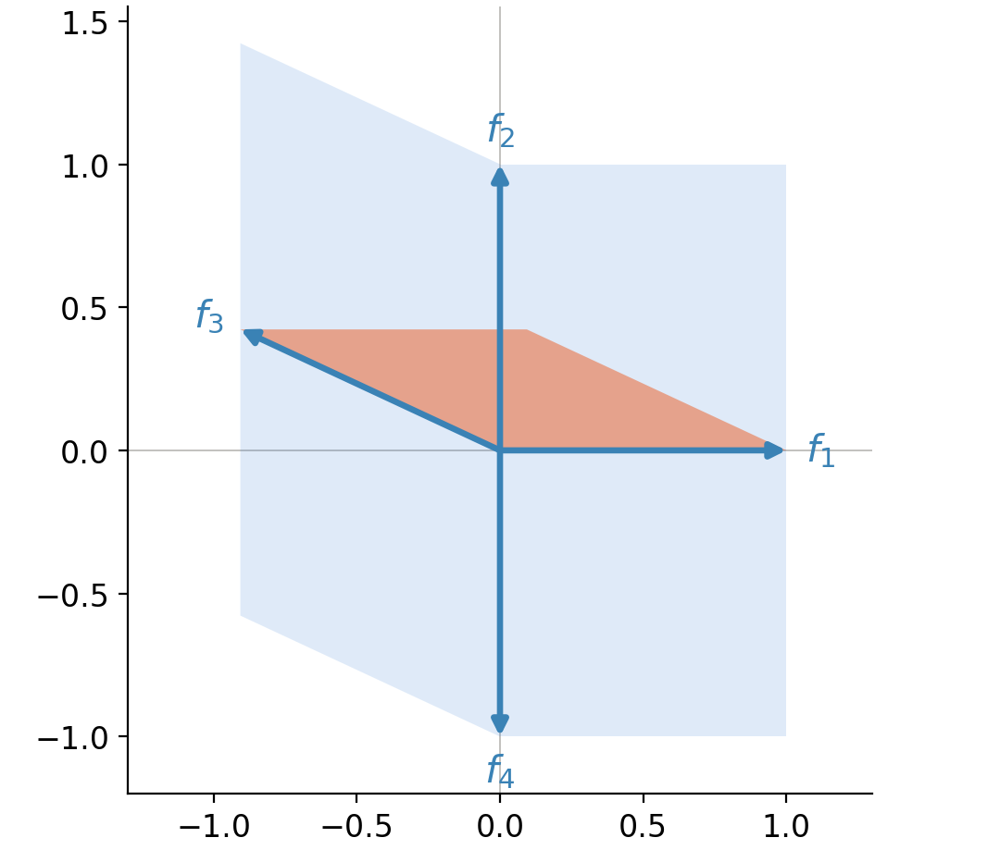

- Still, this strategy is better than not tilting at all: to get a reading on the overlapping line segment, $x_1$ and $x_3$ would have to be co-active **and** produce a reading landing exactly on the $f_2$ embedding, which is extremely rare.

---

### Best possible strategy

To summarize, the **best possible strategy should balance three mechanisms**:
- It can make the embeddings of a pair **asymmetrical**, which lowers the overall MSE,
- It can **tilt** the pairs open, so that co-activation can be told apart from a single active feature,
- But at the same time it needs to account for the **interference** with the other pair's features.

---

### Best possible strategy

- We can find the theoretically best possible arrangement of embeddings by changing their length and tilt, and scoring the final result using the binned decoder (with bins being in this case small 2D squares instead of extremely short line segments).

- This kind of search results in the following arrangement:

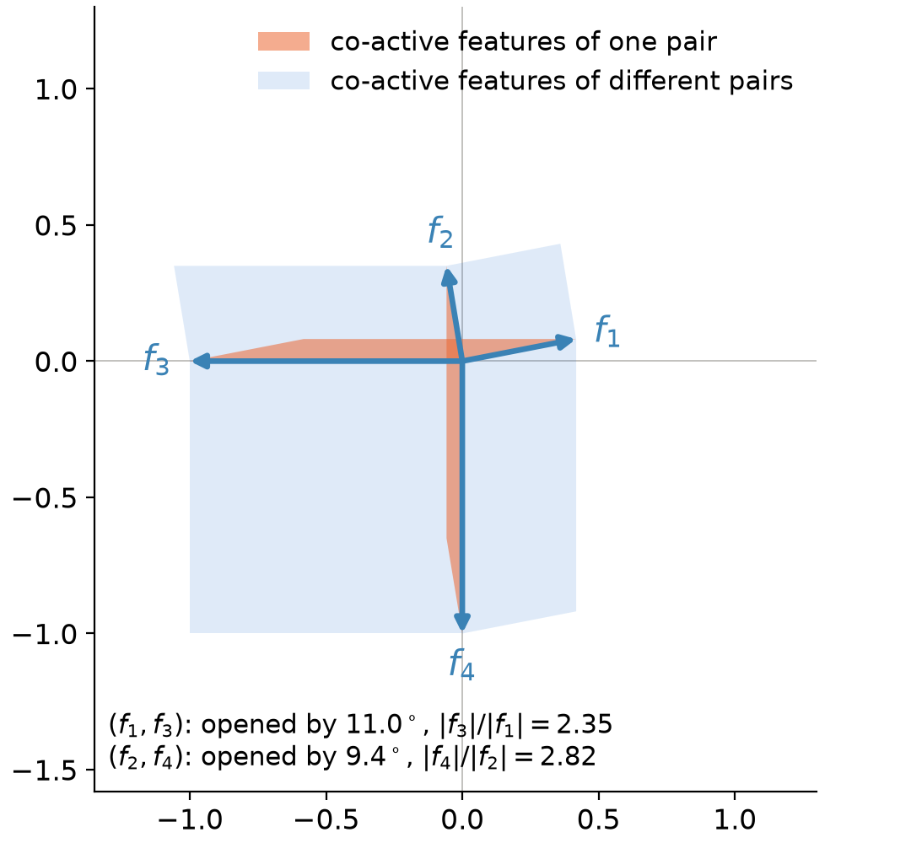

---

### Best possible strategy

- We can notice that the paired features are clearly asymmetrical and tilted.

- But the $f_1$ and $f_2$ embeddings came out extremely short. It turns out that they are shortened in order to reduce the aforementioned interference.

---

### The actual arrangements discovered by the models

- We can compare the representative results from a model with only a single bilinear MLP (shallow) vs a model with four such layers (deep):

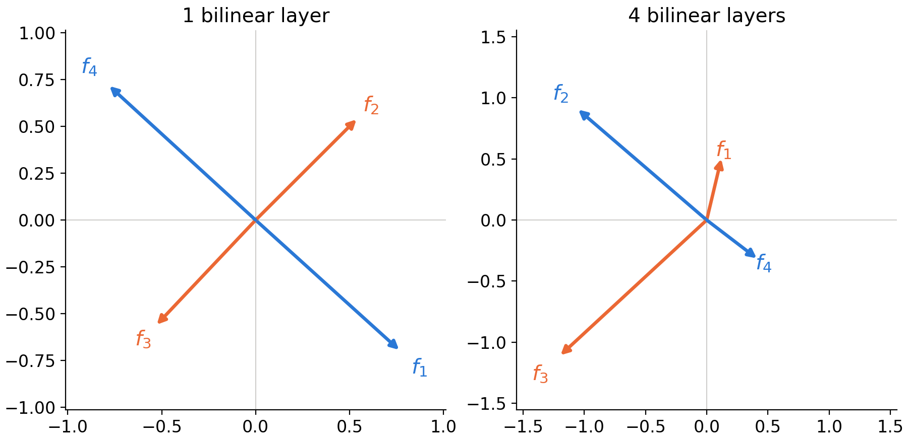

- Clearly, only the deeper model utilizes the strategies mentioned previously. Why is that?

---

### Why do only deep models utilize asymmetry?

- The depth of a model corresponds to its expressivity. A model with a single bilinear MLP can be understood as a 2nd-degree polynomial, while the model with four MLPs is a 16th-degree polynomial.

- With this in mind and having the best theoretical decoder as a benchmark, we can look for the best-in-class approximation of the unconstrained solution.

---

### Why do only deep models utilize asymmetry?

- Below we show the theoretical decoder in gray, together with its approximations as the colored curves.

- For a 2nd-degree polynomial (shallow model) we can clearly see that it approximates the symmetrical case better than the asymmetrical one:

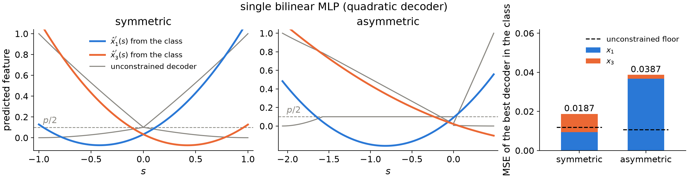

- Because of that it will default to the symmetrical case.

---

### Why do only deep models utilize asymmetry?

- The 16th-degree polynomial (deep model) has no problem approximating both the symmetrical and asymmetrical cases, so it chooses the one which gives a smaller overall MSE:

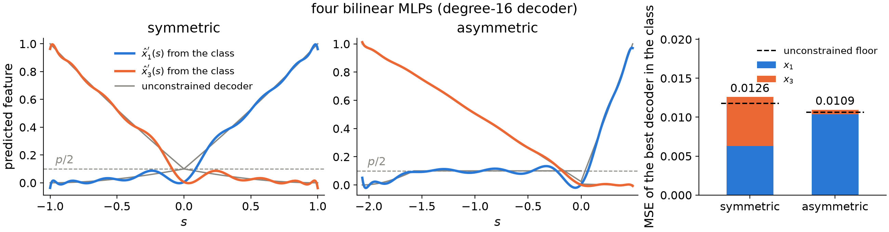

---

### Why do only deep models utilize asymmetry?

- We also studied the model investigated in the *Toy Models of Superposition* paper.

- Similarly to the shallow bilinear model, it cannot properly approximate the asymmetrical solution, so it will default to the symmetrical one:

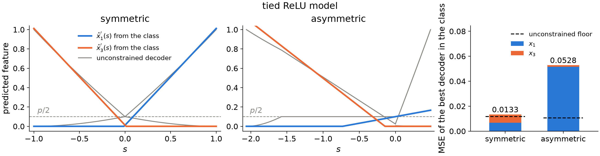

---

### Why do only deep models utilize tilt?

- To understand why only deeper models utilize the tilting of the pair, we can run a similar experiment.

- This time we will fix the geometry to the previously shown case, with just one embedding being slightly tilted. We will focus on the line segment cutting the plane as shown below:

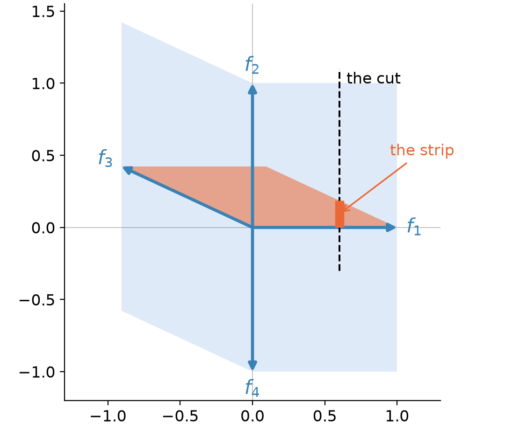

- For this arrangement we can fit the binned decoder as well as constrained functions corresponding to the models with bilinear and ReLU activations.

---

### Why do only deep models utilize tilt?

- It turns out that, again, the expressivity of the model explains why it can or cannot use the tilting.

- Below we can see the results of the fitting procedure:

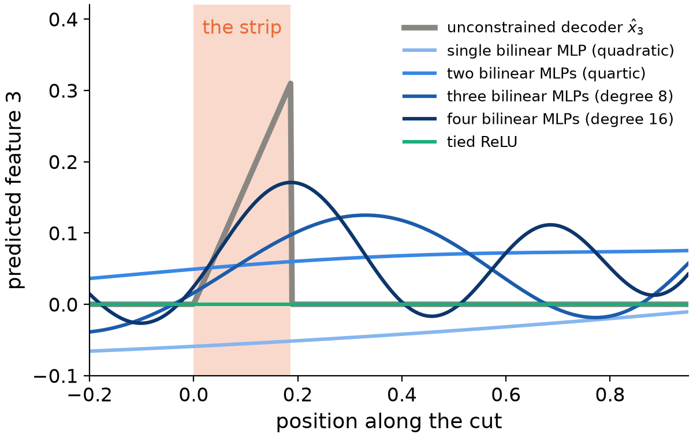

- The binned decoder can very efficiently detect this opening of a pair. The shallow models are too simple to detect such a narrow opening. Only models with 3 and 4 bilinear MLPs are expressive enough to detect the opening.

---

### Summary

- We've shown that the symmetrical geometries formed by the feature embeddings, discovered in *Toy Models of Superposition* in experiments with features of equal importance and sparsity, and with no correlation, are an artifact of the chosen model architecture rather than a general phenomenon.

- We've presented several asymmetrical strategies, which the models can use to reduce the overall MSE.

- Only deep models can utilize these strategies, thanks to their greater expressivity compared to their shallow counterparts.
